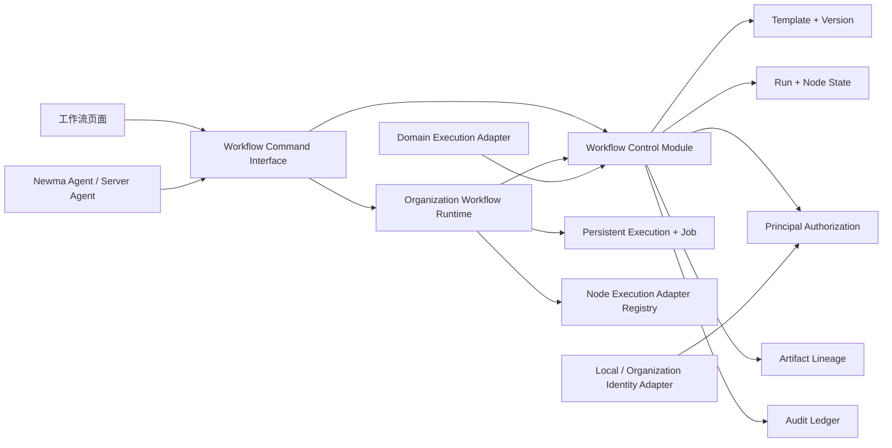
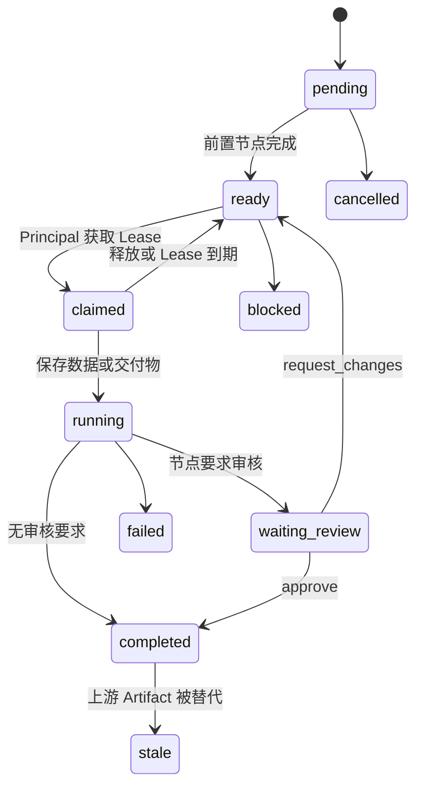
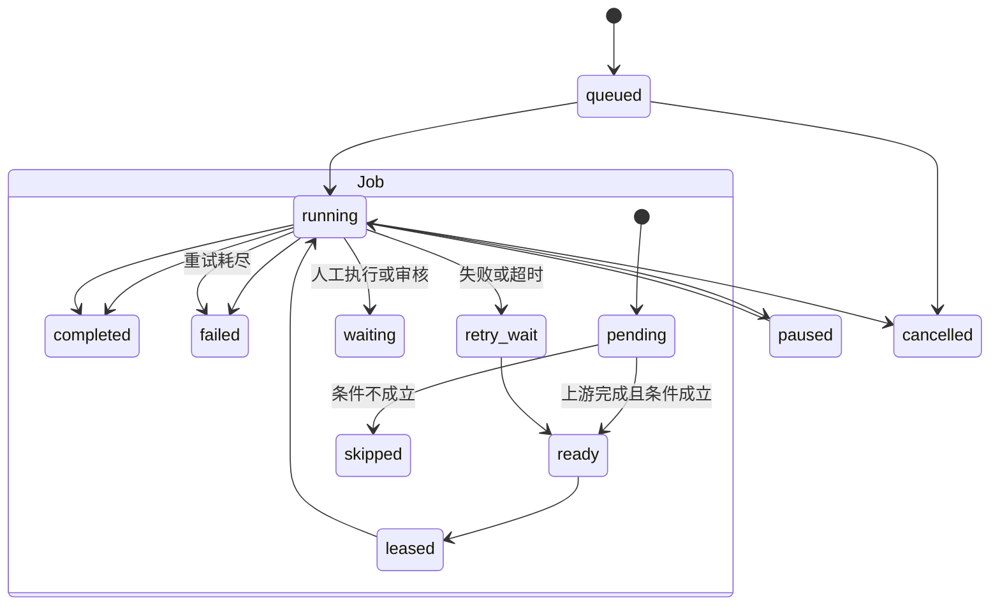

# Newma-Desk 组织工作流标准

## 目标

Workflow Control Module 让组织把投研、投决、创作、运营或其他协作过程表达为一套可复用、可运行、可授权、可交付、可审计的工作流。

它解决五件事：

1. 多节点 DAG 编排与模板版本。
2. 每个节点的数据、交付物和输入谱系保存。
3. 人和服务器 Agent 的责任分配与协同执行。
4. 跨多个工作流的授权、被授权和有限转授权。
5. 责任人、实际执行者和授权来源的统一审计。

## 深 Module



Workflow Command Interface 是调用方唯一需要理解的 Seam。模板校验、状态机、权限解析、租约、版本、stale 传播和审计全部留在 Implementation 中。Identity 与真实节点执行只有在存在第二个实现时才增加新的 Adapter。

## 组织结构

```text
Organization
├── Principal
│   ├── Human
│   └── Server Agent
├── Workflow Template
│   └── Template Version
├── Workflow Run
│   ├── Organization Workflow Node
│   ├── Node Assignment
│   ├── Execution Claim
│   ├── Node Data Revision
│   └── Workflow Artifact
├── Delegation Grant
└── Workflow Audit Ledger
```

### Principal

- Human：组织成员。
- Server Agent：有稳定 ID、显示名、能力标签和可选服务器端点的 Agent 身份。
- Principal 可以同时承担多个工作流节点，也可以同时拥有多条 incoming 和 outgoing Grant。
- Agent 会话不是 Principal。会话断开不改变 Assignment 或 Grant。

### 责任与权限分开

| 概念 | 含义 | 是否被授权替换 |
|---|---|---|
| accountable principal | 对节点结果负责 | 否 |
| reviewer principal | 对 Gate 或交付验收负责 | 否 |
| acting principal | 实际执行本次动作 | 每次动作不同 |
| Delegation Grant | acting principal 的权限来源 | 可撤销 |
| Execution Claim | 短期独占执行租约 | 到期或释放 |

授权人覆盖一个节点时，Workflow Audit Ledger 仍记录原 accountable principal。改派责任必须使用独立 Assignment Command，不能通过 Grant 隐式完成。

## Workflow Template

Template 保存：

- Workflow Matrix：纵向 Lane、横向 Stage，以及每个 Node 的稳定坐标引用。
- Node：ID、名称、说明、role key、类型、审核要求、预期输出、Executor ID、Retry 和 Timeout。
- Edge：source、target、条件和结构化参数；图必须是 DAG。
- Version：定义、变更说明、创建人和时间。

启动 Run 时固定 Template Version。模板的新版本不会改变已经启动的 Run。

### Workflow Matrix 与执行图

```text
             Stage 1       Stage 2       Stage 3
Lane A          A1            A2            A3
Lane B          B1            B2            B3
Lane C          C1            C2            C3
```

- Lane 是纵向业务域和工作流内部二级模块。
- Stage 是横向流程阶段和画布顶部三级标签。
- 每个坐标最多放一个主 Node；空坐标允许保留。
- A1、C3 是派生显示坐标，Node ID 才是稳定身份。
- DAG Edge 独立于矩阵坐标，允许跨行、跨列依赖。
- 成熟 Node 可以提升为所属 Lane 的快捷入口，但不会从画布或 Run 中复制出第二份状态。

## Workflow Run 与节点状态



当前实现将 `claimed` 作为明确状态；第一次保存节点数据或 Artifact 后进入 `running`。Run 含 cancelled 节点且其余节点也全部终止时进入 cancelled，否则全部 completed、cancelled 或 skipped 后进入 completed。

## Organization Workflow Runtime

Workflow Control 继续掌握责任、授权、Run document、Artifact 和审计；Runtime 只掌握 Execution、Job、Trigger、条件判断、Retry、Timeout、Pause、Resume、Cancel 和 Idempotency。



- `(organization, run, idempotencyKey)` 唯一，重复 Trigger 返回同一 Execution。
- 条件表达式使用白名单 AST，只支持布尔、比较和 `run/node/data/artifact/result` 路径，不使用 `eval`。
- Runtime Job 使用持久租约，应用重启后继续领取 pending、ready、retry_wait 或已过期 Job。
- Adapter 只接收结构化参数。内置 `noop`、`data_transform`、`approval_wait`、`agent_handoff`、`agent_runtime`、`server_agent` 和 `http_capability`，不允许任意 Shell、Python 或用户脚本。
- Adapter 输出保存为节点 `runtimeOutput` 数据版本，再由 Workflow Control 受控完成节点并写入 Audit Ledger。
- `agent_runtime` 只通过现有 Agent Gateway 创建任务；独立 Desk 可路由到本地 CLI，Newma / Hermes 环境可路由到兼容 Runtime。Workflow 不直接执行模型或命令。
- `server_agent` 把任务交给远端 Desk API；远端 Desk 仍通过自己的统一 Agent Gateway 选择 Newma、Hermes 或本地 CLI，不创建第二套 Agent 内核。
- 远端 Principal 必须为 active、具备 `workflow.execute` 能力，且 Endpoint Host 位于 `NEWMA_DESK_WORKFLOW_SERVER_AGENT_ALLOWED_HOSTS` 白名单。
- `http_capability` 只调用 Data Service Registry 中已登记的 Capability；节点不能覆盖 URL、Method、Header 或认证信息。
- Agent Task ID 持久保存到 Job Result。后续 Tick 轮询同一任务，不增加执行尝试次数；失败或超时后才按 Retry Policy 创建新任务。
- 运行中心在存在可调度 Job、到期重试或 Agent 外部任务时自动发送后续 Tick；人工“推进”仍保留用于立即检查和诊断。
- Pause 停止 Workflow 继续调度，但不伪造外部任务暂停；Cancel 会同步取消仍在执行的 Agent Task。
- 需要人工审核的 Agent 节点在 Agent 完成后进入 `waiting_review`，Runtime 不会再次轮询或绕过 Reviewer。

### Trigger 与签名入口

- Schedule Trigger 必须二选一：固定 `intervalSeconds`，或标准 Cron `cronExpression`。
- Cron Trigger 保存 IANA `timezone`，默认 `Asia/Shanghai`；暂停时清空下一次时间，重新启用后从当前时间重新计算，不补跑停机期间的全部窗口。
- 外部事件使用 `POST /api/workflows/runtime/webhooks/events/{eventType}`，Body 最大 256 KB。
- Webhook Headers 为 `X-Workspace-Id`、`X-Newma-Webhook-Timestamp`、`X-Newma-Webhook-Signature`；签名 Scope 为 `webhook:{workspaceId}:{eventType}`。
- HMAC-SHA256 消息为 `timestamp + "\\n" + scope + "\\n" + rawBody`，签名格式为 `sha256=<hex>`；默认只接受前后 300 秒内的请求。

### Remote Server Agent Protocol

目标 Endpoint 是远端 Desk API 基址，不是模型、Hermes 或 CLI 地址。双方配置同一个 `NEWMA_DESK_WORKFLOW_SERVER_AGENT_SECRET`。

```text
POST /api/workflows/runtime/remote-agent/tasks
GET  /api/workflows/runtime/remote-agent/tasks/{taskId}
POST /api/workflows/runtime/remote-agent/tasks/{taskId}/cancel
```

请求 Headers 为 `X-Workspace-Id`、`X-Newma-Agent-Timestamp`、`X-Newma-Agent-Signature`，签名 Scope 为 `remote-agent:{workspaceId}:{method}:{path}`。接收端把 Workspace 写入 Agent Task Context，后续查询和取消必须匹配同一 Workspace，避免跨组织读取任务。

### Whitelisted HTTP Capability

`http_capability` 复用现有 Data Service Registry 与 Client，因此沿用以下安全边界：

- Capability ID、服务、Method、Path、输入与输出 Schema 都必须预先登记在 `data-service.json`。
- 本地模式要求目标 Host 位于服务 Descriptor 的 `allowedHosts`；公网模式拒绝 localhost、私网、环回和链路本地地址。
- 认证只读取 Descriptor 引用的服务端环境变量，不接受画布传入的 Token 或 Header。
- 禁止重定向，输入与输出均按 JSON Schema 校验。
- 默认只允许 `market.read`、`research.read`、`analysis.read`；write Permission 必须加入 `NEWMA_DESK_WORKFLOW_HTTP_ALLOWED_PERMISSIONS` 后才能执行。
- Adapter 等待时间取节点 Timeout 与 `NEWMA_DESK_WORKFLOW_HTTP_TIMEOUT_SECONDS` 的较小值。

节点参数示例：

```json
{
  "capabilityId": "market.quote",
  "serviceId": "market-data",
  "input": { "market": "CN" },
  "mapping": { "symbol": "input.symbol" }
}
```

`mapping` 的路径只读取当前 Workflow Context 中的 `run`、`node`、`input`、`data`、`artifact` 和 `result`，用于把上游结果传入已登记 Capability。

## 授权模型

### Scope

Scope 从大到小：

```text
organization
└── template
    └── run
        ├── node
        └── role
```

- organization：整个组织。
- template：模板及由它产生的 Run。
- run：单个运行及其中节点、职能。
- node：单个运行中的单个节点。
- role：某模板全部 Run 或某个 Run 中具有相同 role key 的节点。

### Action

- read：读取。
- write：写节点数据和 Artifact。
- execute：Claim、Release、Submit。
- review：审核 Gate。
- assign：修改 Node Assignment。
- delegate：继续授权。
- admin：管理指定 Scope。

### 不扩权规则

创建子 Grant 时必须同时满足：

1. 子 Scope 被父 Scope 包含。
2. 子 Actions 是父 Actions 的子集。
3. 授权者拥有 delegate Action。
4. 父 Grant 明确允许转授权。
5. 子最大转授权深度小于父剩余深度。
6. 子有效期不晚于父 Grant。
7. 父 Grant 有效且其全部祖先有效。

若授权来自 Node Assignment，而非上游 Grant，Accountable Principal 可以在该 Node 内授权 read、write、execute 和 delegate，但不能扩成 run、template 或 organization Scope。

### 撤销

撤销一条 Grant 时，所有 `parentGrantId` 指向它或其后代的 Grant 同时变为 revoked。历史事件保留原 Grant ID，不删除记录。

## Execution Claim

- 一个 Run Node 同时只能有一个有效 Lease。
- Claim 保存 acting principal、Lease 到期时间和 Claim ID。
- 同一 Principal 可以续租。
- 其他 Principal 即使有 execute 权限，也必须等待 Lease 到期或释放。
- Submit、Review 完成或 Release 会清除 Claim。
- Claim 不改变 Node Assignment。

## 节点数据与交付物

### Node Data Revision

每个 `(run, node, slotKey)` 独立递增版本。适合保存：

- 结构化输入和参数。
- 研究证据摘要。
- 阶段判断与待核验项。
- 人工备注和 Agent 中间结果。

### Workflow Artifact

Artifact 保存：

- 稳定 artifact key 与递增 version。
- label、kind、URI 或小型内容。
- metadata。
- producer principal 与 node。
- input artifact IDs。
- current、stale 状态。

同一节点同一 artifact key 产生新版本时，旧版本继续保留但不再 current。仍引用旧版本的下游 current Artifact 会递归变为 stale，对应 Node 同时进入 stale。

## 审计

每次变更至少记录：

- organization、run、event type、时间。
- actor principal：实际执行者。
- accountable principal：节点责任人。
- delegation grant：若通过授权执行。
- 最小业务载荷：node、version、decision、stale targets 等。

审计事件只追加，不回写历史显示名或责任关系。

## 页面结构

| 页面 | 核心职责 |
|---|---|
| 工作台 | 模板、运行、待办、Agent、授权摘要 |
| 流程编排 | Node、Edge、role、Gate、输出和模板版本 |
| 运行中心 | Assignment、Claim、数据、Artifact、Submit、Review |
| 授权中心 | Scope、Action、转授权和撤销链 |
| 交付物 | 当前版本、输入谱系和 stale 状态 |
| 审计账本 | actor、accountable、Grant 和事件载荷 |
| 组织与 Agent | Human / Server Agent Registry |

## 与投决会、创作的关系

- Creator Studio：继续使用 Creator Run Control。未来新增 Creator Workflow Adapter，把创作 Run 的阶段摘要、Gate 和 Artifact 引用投影到组织 Workflow；不复制编辑器工程和发布状态。
- Orchestra：继续掌握现有投委会运行。未来新增 Orchestra Decision Adapter，把议题、席位、反方意见、主席决议和复核日期映射为组织节点与交付物。
- 新组织流程：直接使用 Workflow Control Module，不依赖 Creator 或 Orchestra。

## 本地身份与远程部署

当前 Desk 仅本地测试：

- Workspace ID 作为 Organization ID。
- `X-Workflow-Principal-Id` 作为本地 Identity Adapter，便于在页面切换 Human 与 Server Agent 验证授权。

Server Agent 的 HMAC 验签、时间窗口、防重放幂等和 Host 白名单已经实现。若恢复公网部署，仍必须增加：

1. 可验证的用户和 Agent 凭证。
2. Principal 与凭证映射。
3. 每组织密钥轮换或短期服务令牌。
4. 入口速率限制、HTTPS 与网络边界。
5. 组织成员目录与停用同步。

这些变化只替换 Identity Adapter；Workflow Command Interface、Grant、Assignment、Claim 和 Audit 语义保持不变。

## 当前交付与下一 Seam

当前代码已实现模板版本、Run、Assignment、Grant、不扩权、撤销级联、Claim Lease、Node Data Revision、Artifact 版本与 stale 传播、审计、持久 Workflow Runtime 状态机与 API，以及本地 Agent、远程 Agent、白名单 HTTP Capability 三类真实执行 Adapter。服务端 Runtime Worker 独立于浏览器推进 Execution、Agent 轮询、重试、超时与重启恢复；运行中心只读取服务端事实状态。流程编排可配置 Executor、Retry 和 Timeout。

Runtime 支持三类真实入口：

- API：直接启动指定 Run，创建后由 Worker 接管。
- Event：持久 Event Trigger 按事件名匹配，并从蓝本 Run 生成新的 Run 实例。
- Schedule：持久固定间隔或 Cron + 时区 Trigger 到期后生成新的 Run 实例；同一触发时刻使用确定性 Run ID 和幂等键，进程重启或并发扫描不会重复生成。
- Signed Webhook：外部系统可用 HMAC 签名发布 Event，Workspace、事件名、时间戳和原始 Body 均受签名保护。

Event 与 Schedule Trigger 保存创建者、蓝本 Run、默认输入和启用状态。每次触发生成独立 Run，不能反复修改已经完成的 Run。

下一步是让流程编排直接读取 Capability Catalog，提供类型化参数表单；对显式开放的 write Permission 增加确认 Gate。公网身份认证、密钥轮换和入口限流仍属于恢复远程部署前的必做项。

执行 Adapter 只能领取并执行已授权节点，不能自行修改 Assignment 或扩大 Grant。
